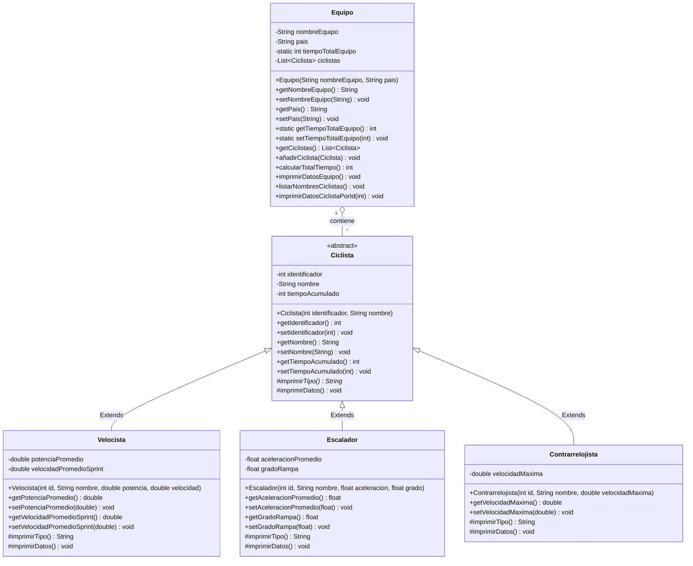

# 🚴 Proyecto Carrera Ciclística - Java POO

> **Institución Universitaria Antonio José Camacho (UNIAJC)**  
> **Asignatura:** Programación Orientada a Objetos  
> **Docente:** Guía del Taller / Carrera Ciclística  

---

## 👥 Integrantes y División del Trabajo

| Nombre del Integrante | Rol / Módulo Asignado | Rama Git | Usuario GitHub |
| :--- | :--- | :--- | :--- |
| **Erick J. Enríquez** | Arquitectura Base, Especialidades, Gestión de Equipo, Pruebas Unitarias y Documentación | `main`, `feature/*` | [@Erick-alt312](https://github.com/Erick-alt312) |


### Estructura de Ramas del Repositorio
* `main`: Rama de producción con el código fuente estable y probado.
* `feature/clase-abstracta-ciclista`: Modelado de la superclase abstracta `Ciclista`, atributos protegidos/privados y métodos base.
* `feature/especialidades-ciclistas`: Implementación de las subclases de especialidad (`Velocista`, `Escalador`, `Contrarrelojista`) y polimorfismo.
* `feature/clase-equipo-y-main`: Gestión de listas dinámicas (`List<Ciclista>`), atributo estático `tiempoTotalEquipo`, búsqueda por ID y clase principal `Main`.
* `feature/pruebas-unitarias`: Suite de 15 pruebas unitarias automatizadas con **JUnit 5**.
* `feature/documentacion-readme`: Documentación técnica completa y diagrama UML en formato Mermaid.

---

## 📋 Descripción del Ejercicio

En una carrera ciclística:
1. Un **Equipo** está conformado por un conjunto de ciclistas. Se identifica por:
   * `nombreEquipo` (`String`, privado).
   * `pais` (`String`, privado).
   * `tiempoTotalEquipo` (`int`, atributo estático y privado): suma en minutos de los tiempos de sus ciclistas.
   * `ciclistas` (`List<Ciclista>`, privado): lista dinámica de ciclistas que componen el equipo.
2. Un **Ciclista** es una **clase abstracta** caracterizada por:
   * `identificador` (`int`, privado).
   * `nombre` (`String`, privado).
   * `tiempoAcumulado` (`int`, privado, inicializado en cero minutos).
   * Método abstracto `imprimirTipo()` que devuelve un `String` con el formato `"Es un xxx"`.
   * Método `imprimirDatos()` para mostrar la información del corredor.
3. Clasificación por **Especialidad** (heredan de `Ciclista`):
   * **Velocista:** incorpora `potenciaPromedio` (en vatios, `double`) y `velocidadPromedioSprint` (en km/h, `double`).
   * **Escalador:** incorpora `aceleracionPromedio` (en m/s², `float`) y `gradoRampa` (en grados, `float`).
   * **Contrarrelojista:** incorpora `velocidadMaxima` (en km/h, `double`).

---

## 📐 Diagrama de Clases UML



---

## 🧩 Principios de POO Implementados

1. **Abstracción:**  
   La clase `Ciclista` define un modelo general que no puede ser instanciado directamente, obligando a cada tipo especializado a implementar el comportamiento concreto de `imprimirTipo()`.
2. **Herencia:**  
   `Velocista`, `Escalador` y `Contrarrelojista` reutilizan los atributos y métodos de `Ciclista`, invocando el constructor padre mediante `super(identificador, nombre)`.
3. **Polimorfismo:**  
   La clase `Equipo` manipula una lista homogénea de tipo `Ciclista` (`List<Ciclista>`), pero en tiempo de ejecución invoca de manera polimórfica los métodos `imprimirTipo()` e `imprimirDatos()` de cada subclase concreta.
4. **Encapsulamiento:**  
   Todos los atributos se encuentran declarados como `private`, restringiendo el acceso directo y proporcionando métodos de acceso (`getters` y `setters`) con la visibilidad adecuada.
5. **Variables y Métodos Estáticos:**  
   `tiempoTotalEquipo` es un atributo estático compartido por la clase `Equipo`, permitiendo acumular el tiempo total de carrera de los ciclistas registrados.

---

## 🧪 Casos de Pruebas Unitarias (JUnit 5)

El proyecto cuenta con una suite automatizada de **15 pruebas unitarias** divididas en 4 clases de test:

| Clase de Prueba | Caso de Prueba | Descripción | Resultado Esperado |
| :--- | :--- | :--- | :--- |
| `VelocistaTest` | `testAtributosIniciales` | Verifica inicialización de ID, nombre, tiempo acumulado en 0, potencia y velocidad sprint. | Valores idénticos a los del constructor. |
| `VelocistaTest` | `testImprimirTipo` | Valida que `imprimirTipo()` retorne el texto correspondiente. | Retorna `"Es un Velocista"`. |
| `VelocistaTest` | `testModificarAtributos` | Prueba setters de potencia, velocidad y tiempo acumulado. | Atributos actualizados correctamente. |
| `EscaladorTest` | `testAtributosIniciales` | Verifica aceleración en subida y grado de rampa. | Valores coincidentes con precisión delta. |
| `EscaladorTest` | `testImprimirTipo` | Valida el método polimórfico `imprimirTipo()`. | Retorna `"Es un Escalador"`. |
| `EscaladorTest` | `testModificarAtributos` | Valida setters de atributos de escalador. | Modificaciones reflejadas con éxito. |
| `ContrarrelojistaTest` | `testAtributosIniciales` | Verifica velocidad máxima y atributos base. | Valores inicializados correctamente. |
| `ContrarrelojistaTest` | `testImprimirTipo` | Valida el método polimórfico `imprimirTipo()`. | Retorna `"Es un Contrarrelojista"`. |
| `ContrarrelojistaTest` | `testModificarAtributos` | Valida modificación de velocidad máxima y tiempos. | Atributos modificados con éxito. |
| `EquipoTest` | `testCrearEquipo` | Verifica nombre del equipo, país y lista vacía inicial. | Atributos iniciales correctos. |
| `EquipoTest` | `testAñadirCiclistas` | Valida adición de múltiples ciclistas a la lista dinámica. | Tamaño de la lista incrementa a 3. |
| `EquipoTest` | `testCalcularTotalTiempo` | Valida suma estática de tiempos: 120 + 110 + 115 = 345 min. | `tiempoTotalEquipo == 345`. |
| `EquipoTest` | `testBuscarCiclistaPorIdExiste` | Busca ciclista existente por ID (ej. 101) e imprime sus datos. | Localizado sin excepciones. |
| `EquipoTest` | `testBuscarCiclistaPorIdNoExiste` | Busca un ID inexistente (ej. 999). | Mensaje de no encontrado sin errores. |
| `EquipoTest` | `testListarNombresCiclistas` | Lista nombres en equipo vacío y equipo poblado. | Ejecución limpia sin excepciones. |

---

## 🚀 Compilación y Ejecución

### Requisitos Previos
* **Java Development Kit (JDK):** Versión 17 o superior (probado en JDK 21).
* **Apache Maven:** Versión 3.8 o superior.
* **Git:** Para clonar el repositorio y gestionar ramas.

### 1. Clonar el Repositorio
```bash
git clone https://github.com/Erick-alt312/ejemciclista.git
cd ejemciclista
```

### 2. Compilar el Proyecto
```bash
# Desde la raíz del proyecto
mvn clean compile

# O dentro del módulo demo
cd demo
mvn clean compile
```

### 3. Ejecutar las Pruebas Unitarias
```bash
cd demo
mvn test
```

### 4. Ejecutar la Aplicación Principal
```bash
cd demo
mvn exec:java -Dexec.mainClass="com.ejemciclistas.Main"
```
*(También se puede ejecutar directamente desde VS Code o IntelliJ presionando `Run` sobre el archivo `Main.java`)*.

---

## 💻 Ejemplo de Ejecución en Consola

```text
========================================================
   GESTION DE CARRERA CICLISTICA - UNIAJC              
========================================================

=========================================
            DATOS DEL EQUIPO             
=========================================
Nombre del equipo: Movistar Team
Pais de origen: Colombia
Tiempo total del equipo: 345 minutos
Cantidad de ciclistas: 3
-----------------------------------------
Detalle de ciclistas integrantes:
-----------------------------------------
Identificador: 101
Nombre: Fernando Gaviria
Tiempo acumulado: 120 minutos
Tipo: Es un Velocista
Potencia promedio: 365.0 vatios
Velocidad promedio sprint: 68.5 km/h
-----------------------------------------
Identificador: 102
Nombre: Nairo Quintana
Tiempo acumulado: 110 minutos
Tipo: Es un Escalador
Aceleracion promedio en subida: 3.85 m/s^2
Grado de rampa soportada: 15.5 grados
-----------------------------------------
Identificador: 103
Nombre: Daniel Felipe Martinez
Tiempo acumulado: 115 minutos
Tipo: Es un Contrarrelojista
Velocidad maxima: 59.2 km/h
=========================================

Ciclistas pertenecientes al equipo 'Movistar Team':
- Fernando Gaviria (Es un Velocista)
- Nairo Quintana (Es un Escalador)
- Daniel Felipe Martinez (Es un Contrarrelojista)

--------------------------------------------------------
Ingrese el identificador del ciclista a buscar: 102

[+] Ciclista localizado con ID 102:
Identificador: 102
Nombre: Nairo Quintana
Tiempo acumulado: 110 minutos
Tipo: Es un Escalador
Aceleracion promedio en subida: 3.85 m/s^2
Grado de rampa soportada: 15.5 grados
```
